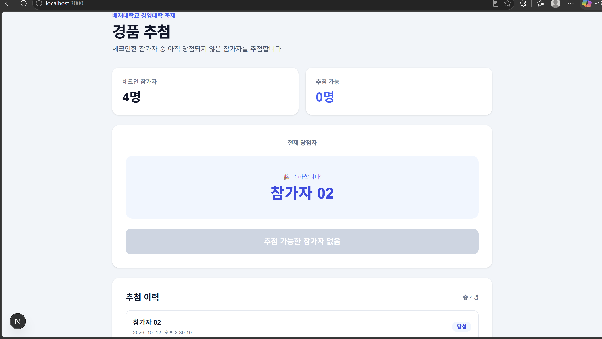

# Nexus Prize Draw

배재대학교 경영대학 축제의 경품 추첨 기능을 검증하기 위한 프로토타입입니다.

이 프로젝트는 공식 행사 시스템에 바로 연결하기 전에 경품 추첨의 핵심 동작을 개인 환경에서 검증하는 것을 목적으로 합니다.

## 프로그램 실행 화면

아래는 경품 추첨 프로토타입의 실행 화면입니다



## 구현 기능

- 체크인한 참가자만 추첨 후보로 선정
- 경품 추첨 시작
- 당첨자 표시
- 이미 당첨된 참가자는 다음 추첨에서 제외
- 추첨 이력 표시
- 추첨 가능한 참가자가 없을 경우 추첨 버튼 비활성화
- 테스트 참가자 데이터 사용

## 테스트 데이터

현재 프로토타입에서는 실제 학생 개인정보를 사용하지 않습니다.

예시:

- 참가자 01
- 참가자 02
- 참가자 03
- 참가자 04
- 참가자 05

## 실행 방법

의존성 설치:

## 실행 방법

### 1. 의존성 설치

```bash
npm install
```

### 2. 개발 서버 실행

```bash
npm run dev
```

### 3. 브라우저에서 확인

브라우저 주소창에 다음 주소를 입력합니다.

```text
http://localhost:3000
```

### 4. 테스트 실행

```bash
npm test
```

## 현재 한계 및 향후 개선 사항

- 현재는 테스트 참가자 데이터를 사용하며, 실제 행사 참가자 데이터와 연동되어 있지 않습니다.
- 공식 행사 시스템과의 연동은 아직 구현되지 않았습니다.
- 실제 행사에 사용하기 위해서는 참가자 데이터 연동과 행사 환경에서의 추가 검증이 필요합니다.

## 개발 환경

- Next.js
- TypeScript
- Tailwind CSS
- Vitest

